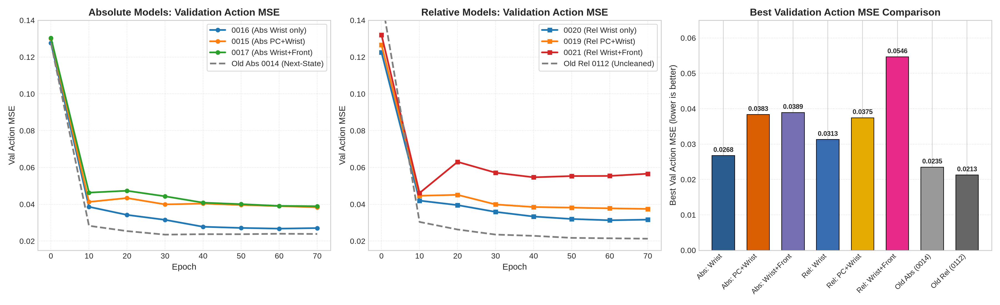

# Modalitäts-Ablation & Konsistenz-Analyse: 6 neue Trainingsruns vs. 2 alte Baselines

Diese Auswertung vergleicht die **6 neuen Ablations-Trainingsruns** (`0015`, `0016`, `0017`, `0019`, `0020`, `0021` auf `foil_lifting_box_recorded_action.zarr`) systematisch mit den **2 alten Baseline-Trainingsruns** (`old_abs_0112` und `old_rel_0112` auf `foil_lifting_wrist_tesollo.zarr`).

Der Fokus liegt auf drei Fragen:
1. Wie unterscheiden sich Trainingskonfigurationen, Koordinatenräume und Validierungs-Metriken zwischen den 6 neuen und 2 alten Modellen?
2. Welche Modalitäten (`wrist_rgb`, `front_rgb`, `point_cloud`, `state`) nutzen die 8 Modelle tatsächlich in den vier semantischen Task-Phasen (`approach`, `search`, `transition`, `hold`) und auf den einzelnen Achsen (`xy`, `z`, `rot`, `hand`)?
3. Hat sich das Problem der alten Modelle – stark abweichende Vorhersagen bei derselben Position bzw. an aufeinanderfolgenden Chunk-Übergängen – in den neuen Trainingsläufen verbessert?

---

## 1. Übersicht der 8 Trainingsläufe & Setup-Unterschiede

| Run ID | Koordinaten & Modalitäten | Datensatz | Action-Target & Dimension | Proprio Dropout | Best Epoch | Checkpoint Val-MSE (norm.) | Val-MSE gewichtet (`full`) | Val-MSE stratifiziert (`full`) |
| :--- | :--- | :--- | :--- | :---: | :---: | :---: | :---: | :---: |
| `0015_abs_pc_wrist` | Abs: Wrist + PC | `recorded_action.zarr` (323 Ep) | 15D Cmd (`xyz` + `quat` + `hand`) | 0.8 | 70 | 0.03834 | 0.02969 | 0.03472 |
| `0016_abs_wrist_only` | Abs: Wrist only | `recorded_action.zarr` (323 Ep) | 15D Cmd (`xyz` + `quat` + `hand`) | 0.8 | 60 | 0.02675 | 0.02859 | 0.03011 |
| `0017_abs_wrist_front` | Abs: Wrist + Front | `recorded_action.zarr` (323 Ep) | 15D Cmd (`xyz` + `quat` + `hand`) | 0.8 | 70 | 0.03892 | 0.02781 | 0.03158 |
| `0019_rel_pc_wrist` | Rel: Wrist + PC | `recorded_action.zarr` (323 Ep) | 17D Cmd ($\Delta xyz$ + `rot6d` + `hand`) | 0.0 | 70 | 0.03745 | 0.02503 | 0.03295 |
| `0020_rel_wrist_only` | Rel: Wrist only | `recorded_action.zarr` (323 Ep) | 17D Cmd ($\Delta xyz$ + `rot6d` + `hand`) | 0.0 | 60 | 0.03129 | 0.02867 | 0.03185 |
| `0021_rel_wrist_front` | Rel: Wrist + Front | `recorded_action.zarr` (323 Ep) | 17D Cmd ($\Delta xyz$ + `rot6d` + `hand`) | 0.0 | 40 | 0.05464 | 0.03749 | 0.04364 |
| `old_abs_0112` | Abs: Wrist + PC | `wrist_tesollo.zarr` (358 Ep) | 15D Next-State ($s_{t+1}$) | 0.8 | 50 | 0.00943\* | **0.01701** | **0.02161** |
| `old_rel_0112` | Rel: Wrist + PC | `wrist_tesollo.zarr` (358 Ep) | 17D Next-State ($\Delta xyz$ + `rot6d` + `hand`) | 0.0 | 40 | **0.02284** | 0.01946 | 0.02509 |

*\*Hinweis: `old_abs_0112` nutzte beim Training `val_loss` (Flow-Matching-Velocity-Loss `0.104829`) zur Checkpoint-Auswahl; der nachträglich per `sweep_checkpoints.py` bestimmte normalisierte Action-MSE lag bei `0.00943` auf den ersten Sequenz-Batches bzw. `0.01701` über den gesamten Validierungs-Split.*

### Methodische Einordnung der nominellen Loss-Werte

Ein direkter Vergleich des normalisierten Action-MSE zwischen alten und neuen Läufen sowie zwischen 15D-Absolut- und 17D-Relativ-Modellen unterliegt drei strukturellen Effekten:

1. **`next_state` ($s_{t+1}$) vs. `recorded_action` ($a_t^{\text{cmd}}$):**
   * In `foil_lifting_wrist_tesollo.zarr` (`old_abs_0112`, `old_rel_0112`) besteht das Action-Target aus den tatsächlich erreichten Folgezuständen des Roboters (`action == state` zeitverschoben). Durch Massenträgheit und Impedanzregelung sind diese Trajektorien stark tiefpassgefiltert; die Standardabweichung der Zielbewegung innerhalb eines 64er-Fensters beträgt in XY lediglich `gt_xy_std = 0.0352` (norm.).
   * In `foil_lifting_box_recorded_action.zarr` (`0015`–`0021`) ist das Action-Target der aufgezeichnete menschliche Teleoperations-Sollwert. Dieser eilt dem physischen Arm unter Kontakt- und Regler-Compliance voraus und enthält hochfrequente Korrekturen (`gt_xy_std = 0.0627` im 15D-Absolutschnitt, also das `1.78`-Fache). Der nominell niedrigere MSE der beiden alten Modelle resultiert primär aus dieser glatteren Zielgröße.
2. **Normalisierungsmaßstab (15D Absolut vs. 17D Relativ):**
   * `LinearNormalizer` (`limits`-Modus) skaliert jede Dimension auf $[-1, 1]$ anhand der globalen Min/Max-Spanne. Bei 15D-Absolutmodellen umfasst die XY-Spanne den gesamten Arbeitsraum über der Kiste, während 17D-Relativmodelle auf lokale Chunk-Deltas $\Delta xyz$ normiert sind (`gt_xy_std = 0.1289` bei `0019`–`0021`). Ein gleicher physikalischer Millimeter-Fehler erzeugt im relativen Normalisierungsraum daher einen größeren numerischen MSE als im absoluten Raum.
3. **DINOv3-Projektionsdimension (`128` vs. `384`):**
   * In `old_rel_0112` projizierte der `DINOv3ObsEncoder` auf `out_dim = 128`, während alle 6 neuen Läufe auf `out_dim = 384` (passend zur DiTX-Embedding-Dimension `n_emb = 384`) projizieren.

---

## 2. Modalitäts-Ablation & Phasen-Verteilung über alle 8 Modelle

Um zu messen, welche Eingangsmodalitäten die Policies tatsächlich auswerten, wurden pro Modell $N = 192$ stratifizierte Validierungsfenster ($48$ pro Phase: `approach`, `search`, `transition`, `hold`) mit identischem Rausch-Seed $x_0$ evaluiert.

* **`shuffle_*` (Hauptmetrik):** Permutiert die jeweilige Modalität entlang der Batch-Achse. Mittelwert, Varianz und Token-Verteilung bleiben exakt in-distribution; nur die Zuordnung zur aktuellen Beobachtung wird aufgebrochen. Ein Faktor `1.00x` bedeutet, dass das Modell den Informationsgehalt dieser Modalität ignoriert.
* **`zero_*` / `state_only` (Kontrastmetrik):** Setzt die entsprechenden Konditionierungs-Tensoren auf Null. `zero_state` ist nur für Modelle mit `proprio_dropout = 0.8` (`0015`, `0016`, `0017`, `old_abs_0112`) in-distribution; für relative Modelle (`proprio_dropout = 0.0`) ist `zero_state` out-of-distribution (OOD). Bei den 2-Kamera-Modellen (`0017`, `0021`) wurden die Token-Gruppen im DINOv3-Kontext (`front_rgb`: $2 \times 240 = 480$ Tokens, `wrist_rgb`: $2 \times 192 = 384$ Tokens) separat permutiert.

### 2.1 Aggregierte Modalitäts-Abhängigkeit & Achsen-Aufteilung (alle 8 Modelle)

*Hinweis zur Formatierung: In den folgenden Tabellen gibt der Multiplikator (`x full`) bei `shuffle_*` an, wie stark der Fehler steigt, wenn die Modalität unbrauchbar gemacht wird. Für `full` MSE ist der jeweils niedrigste Wert pro Spalte fett markiert; bei den `shuffle_*`-Spalten ist der jeweils höchste Sensitivitätsfaktor fett markiert.*

| Modell | `full` MSE (strat.) | `xy_search` MSE (`full`) | `shuffle_wrist` (`x full`) | `shuffle_front` (`x full`) | `shuffle_all_rgb` (`x full`) | `shuffle_pc` (`x full`) | `shuffle_state` (`x full`) | `zero_state` (`x full`) | `state_only` (`x full`) |
| :--- | :---: | :---: | :---: | :---: | :---: | :---: | :---: | :---: | :---: |
| `0015_abs_pc_wrist` | 0.03472 | 0.01001 | 1.60x | – | – | 1.61x | 2.02x | 2.11x | 2.39x |
| `0016_abs_wrist_only` | 0.03011 | 0.01066 | 2.47x | – | – | – | 2.30x | 2.34x | 2.35x |
| `0017_abs_wrist_front` | 0.03158 | 0.01055 | 1.94x | **1.34x** | 2.36x | – | 1.96x | 2.13x | 2.46x |
| `0019_rel_pc_wrist` | 0.03295 | 0.02295 | 2.26x | – | – | 1.42x | 1.45x | 3.15x | 3.03x |
| `0020_rel_wrist_only` | 0.03185 | 0.02047 | **2.81x** | – | – | – | 1.44x | 2.72x | 3.48x |
| `0021_rel_wrist_front` | 0.04364 | 0.02245 | 1.91x | 1.16x | **2.48x** | – | 1.31x | 1.93x | 2.66x |
| `old_abs_0112` | **0.02161** | **0.00389** | 1.25x | – | – | 1.74x | **4.09x** | **4.29x** | 2.08x |
| `old_rel_0112` | 0.02509 | 0.01373 | 1.71x | – | – | **2.12x** | 1.72x | 4.07x | **6.01x** |

#### Sensitivität nach Achsen-Gruppen (`xy`, `z`, `rot`, `hand` als Multiplikator `x full`)

| Modell | Modalitäts-Test | `xy` (Lateral) | `z` (Höhe) | `rot` (Orientierung) | `hand` (Greifer) | `xy_search` (Entscheidungsfenster) |
| :--- | :--- | :---: | :---: | :---: | :---: | :---: |
| `0015_abs_pc_wrist` | `shuffle_wrist` | 1.22x | 1.59x | 1.30x | 1.74x | 1.24x |
| | `shuffle_pc` | 3.11x | **1.97x** | 1.46x | 1.52x | 3.53x |
| | `shuffle_state` | 4.93x | 1.65x | 1.57x | 2.02x | 6.21x |
| `0016_abs_wrist_only` | `shuffle_wrist` | 1.66x | **2.76x** | 1.70x | 2.85x | 1.67x |
| | `shuffle_state` | **9.06x** | 1.92x | 1.62x | 2.01x | **12.28x** |
| `0017_abs_wrist_front` | `shuffle_wrist` | 1.14x | 1.84x | 1.40x | 2.25x | 1.10x |
| | `shuffle_front` | 1.96x | 1.25x | 1.21x | 1.35x | 1.89x |
| | `shuffle_all_rgb` | 2.11x | 2.32x | 1.79x | 2.62x | 2.01x |
| | `shuffle_state` | 6.09x | 1.55x | 1.37x | 1.89x | 8.57x |
| `0019_rel_pc_wrist` | `shuffle_wrist` | 2.65x | 1.99x | 2.00x | 2.37x | 1.86x |
| | `shuffle_pc` | 1.73x | 1.68x | 1.39x | 1.39x | 1.42x |
| | `shuffle_state` | 1.27x | 1.16x | 1.21x | 1.62x | 0.97x |
| `0020_rel_wrist_only` | `shuffle_wrist` | **3.45x** | 2.29x | **2.45x** | **2.97x** | **2.45x** |
| | `shuffle_state` | 1.14x | 1.09x | 1.17x | 1.64x | 0.92x |
| `0021_rel_wrist_front` | `shuffle_wrist` | 2.44x | 1.80x | 1.80x | 1.90x | 2.20x |
| | `shuffle_front` | 1.27x | 1.20x | 1.34x | 1.08x | 1.31x |
| | `shuffle_all_rgb` | 3.08x | 2.21x | 2.34x | 2.49x | 2.37x |
| | `shuffle_state` | 1.13x | 1.01x | 1.11x | 1.42x | 0.89x |
| `old_abs_0112` | `shuffle_wrist` | 1.15x | 1.53x | 1.07x | 1.32x | 0.93x |
| | `shuffle_pc` | **12.22x** | 2.81x | **1.68x** | 1.28x | **13.00x** |
| | `shuffle_state` | 7.01x | **9.81x** | **5.13x** | **3.37x** | 9.37x |
| `old_rel_0112` | `shuffle_wrist` | 2.35x | 2.12x | 1.64x | 1.68x | 2.31x |
| | `shuffle_pc` | 2.09x | **4.42x** | 1.77x | **2.27x** | 1.83x |
| | `shuffle_state` | 1.33x | 1.16x | 1.25x | 2.07x | 1.07x |

---

### 2.2 Phasen-Verteilung (`approach`, `search`, `transition`, `hold`) für alle 8 Modelle

Die vier Phasen sind über die Greifer-Trajektorie definiert (`maniflow/common/phase_detection.py`):
* **`approach`:** Absenken zur Kiste/Folie (offene Hand, vor dem Entscheidungsfenster).
* **`search` (Entscheidungsfenster `[t_close - 32, t_close - 2)`):** Hand noch offen, exakt ein Action-Chunk vor dem Zufahren – hier wird der laterale Greifpunkt gewählt.
* **`transition`:** Unmittelbares Schließfenster um `t_close`, in dem $z$ das Vorzeichen umkehrt (Eintauchen $\to$ Anheben).
* **`hold`:** Geschlossener Pinch-Griff während des Anhebens/Abziehens der Folie.

| Modell | Phase | `full` (MSE) | `shuffle_wrist` | `shuffle_front` | `shuffle_all_rgb` | `shuffle_pc` | `shuffle_state` | `zero_state` | `state_only` |
| :--- | :--- | :---: | :---: | :---: | :---: | :---: | :---: | :---: | :---: |
| **`0015_abs_pc_wrist`** | `approach` | 0.03543 | 3.01x | – | – | 2.33x | 3.02x | 2.95x | 2.64x |
| | `search` | 0.05361 | 1.34x | – | – | 1.28x | 1.47x | 0.97x | 1.59x |
| | `transition` | 0.03172 | 0.98x | – | – | 1.38x | 1.73x | 1.55x | 3.36x |
| | `hold` | 0.01811 | 0.73x | – | – | 1.59x | 2.22x | 4.82x | 2.59x |
| **`0016_abs_wrist_only`** | `approach` | 0.03553 | 4.35x | – | – | – | 2.43x | 2.48x | 3.08x |
| | `search` | 0.04246 | 1.69x | – | – | – | 1.74x | 1.57x | 1.78x |
| | `transition` | 0.02310 | 2.05x | – | – | – | 2.43x | 1.79x | 2.61x |
| | `hold` | 0.01933 | 1.25x | – | – | – | 3.12x | 4.43x | 1.97x |
| **`0017_abs_wrist_front`** | `approach` | 0.03042 | 4.20x | 1.70x | 4.62x | – | 2.83x | 2.58x | 3.27x |
| | `search` | 0.04050 | 1.60x | 1.26x | 1.66x | – | 1.58x | 1.61x | 2.08x |
| | `transition` | 0.03386 | 1.14x | 1.12x | 1.69x | – | 1.62x | 1.51x | 2.12x |
| | `hold` | 0.02152 | 0.67x | 1.35x | 1.52x | – | 1.98x | 3.48x | 2.60x |
| **`0019_rel_pc_wrist`** | `approach` | 0.02886 | 4.54x | – | – | 2.02x | 1.49x | 4.82x | 3.93x |
| | `search` | 0.04756 | 1.67x | – | – | 1.11x | 1.17x | 1.79x | 2.01x |
| | `transition` | 0.04140 | 1.35x | – | – | 1.13x | 1.33x | 2.05x | 2.69x |
| | `hold` | 0.01399 | 2.22x | – | – | 2.11x | 2.71x | 7.57x | 5.63x |
| **`0020_rel_wrist_only`** | `approach` | 0.03323 | **4.79x** | – | – | – | 1.43x | 3.10x | 3.50x |
| | `search` | 0.04079 | **2.00x** | – | – | – | 1.27x | 1.78x | 2.90x |
| | `transition` | 0.03234 | **2.09x** | – | – | – | 1.46x | 2.16x | 3.85x |
| | `hold` | 0.02102 | **2.36x** | – | – | – | 1.72x | 4.82x | 4.02x |
| **`0021_rel_wrist_front`** | `approach` | 0.03472 | 4.30x | 1.39x | **4.81x** | – | 1.32x | 2.96x | 2.95x |
| | `search` | 0.05568 | 1.53x | 0.99x | 1.82x | – | 1.20x | 1.34x | 2.47x |
| | `transition` | 0.05021 | 1.20x | 1.08x | 1.76x | – | 1.31x | 1.39x | 2.68x |
| | `hold` | 0.03393 | 1.12x | 1.35x | 2.23x | – | 1.46x | 2.64x | 2.63x |
| **`old_abs_0112`** | `approach` | **0.01999** | 1.88x | – | – | 1.69x | **5.33x** | 5.05x | 1.89x |
| | `search` | 0.03995 | 0.98x | – | – | 1.39x | **2.68x** | 2.31x | 1.51x |
| | `transition` | **0.01829** | 1.16x | – | – | **2.07x** | **3.44x** | **4.01x** | 3.03x |
| | `hold` | **0.00821** | 1.29x | – | – | **2.90x** | **9.35x** | **12.76x** | 3.22x |
| **`old_rel_0112`** | `approach` | 0.02184 | 2.51x | – | – | **3.67x** | 1.67x | **6.11x** | **5.11x** |
| | `search` | **0.03811** | 1.45x | – | – | **1.79x** | 1.32x | **2.46x** | **5.00x** |
| | `transition` | 0.02893 | 1.25x | – | – | 1.40x | 1.54x | 2.57x | **8.18x** |
| | `hold` | 0.01146 | 2.18x | – | – | 2.09x | 3.56x | 9.28x | **5.65x** |

---

### 2.3 Teil-Schlussfolgerungen & Hypothesen zur Modalitäts-Nutzung

1. **Warum `old_abs_0112` die Wrist-Kamera im Entscheidungsfenster fast komplett ignorierte – und was sich in `0015`–`0017` geändert hat:**
   * In `old_abs_0112` liegt `shuffle_wrist` im `search`-Fenster bei `0.98x` (und auf `xy_search` bei `0.93x`), während `shuffle_pc` auf `xy_search` einen Anstieg um `13.00x` und `shuffle_state` um `9.37x` (bzw. `9.35x` in `hold`) verursacht. Weil `next_state` ($s_{t+1}$) eine direkte Extrapolation der aktuellen Arm-Kinematik $s_t$ und der globalen Point-Cloud-Boxlage erlaubt, lernte das alte Absolut-Modell einen rein propriozeptiv-geometrischen Shortcut ohne hochauflösende Bildauswertung.
   * Beim Wechsel auf `recorded_action` (`0015_abs_pc_wrist`) steigt die Nutzung der Wrist-Kamera in `approach` (`3.01x` statt `1.88x`) und `search` (`1.34x` statt `0.98x`) an, weil der menschliche Teleop-Impuls (z. B. das gezielte Zustechen in die Folienfalte) nicht mehr allein durch Trägheits-Fortsetzung aus $s_t$ erklärbar ist. Dennoch bleibt in `0015` für die laterale XY-Wahl im Suchfenster die Point Cloud (`3.53x`) und der aktuelle Armzustand (`6.21x`) dominanter als `wrist_rgb` (`1.24x`).
   * Erst wenn die Point Cloud entfernt wird (`0016_abs_wrist_only`), übernimmt `wrist_rgb` die Höhen- (`z: 2.76x`) und Greifersteuerung (`hand: 2.85x`) sowie `transition` (`2.05x`). Allerdings steigt gleichzeitig die `xy_search`-Abhängigkeit von `shuffle_state` auf `12.28x`. **Theorie:** Ein Modell, das *absolute* Weltkoordinaten $(x, y, z)$ vorhersagen muss, aber weder Point Cloud noch Außenkamera besitzt, kann aus dem Nahbereichsbild der Handkamera allein nicht wissen, wo sich der Arm absolut in der Roboterzelle befindet. Es ist zwingend auf `state` als globalen Ursprungsanker angewiesen, auf den es das visuell geschätzte lokale Offset addiert.

2. **Strukturelle Entkopplung von `state` in relativen Koordinaten (`0019`, `0020`, `0021`, `old_rel_0112`):**
   * In sämtlichen relativen Modellen liegt `shuffle_state` für `xy_search` zwischen `0.89x` und `1.07x` (d. h. das Permutieren der Propriozeption verändert die laterale Greifpunktwahl im Suchfenster überhaupt nicht).
   * **Ursache:** In `RelativeRealDexDataset` wird das gesamte Fenster relativ zur letzten beobachteten Pose `state[n_obs_steps - 1]` kodiert. Dadurch ist die aktuelle EE-Pose im Zustandsvektor für *jedes* Sample exakt die Identität $(0, I)$. Der Zustandsvektor enthält räumlich nur noch den 1-Schritt-Rückblick `state[0]` (Momentangeschwindigkeit vor 33 ms) sowie die 8 absoluten Handgelenkwinkel.
   * Folgerichtig verlagert sich die laterale Richtungsentscheidung (`xy_search`) in den relativen Modellen auf die visuellen Modalitäten: `shuffle_wrist` erhöht den `xy_search`-MSE um `1.86x` (`0019`), `2.45x` (`0020`), `2.20x` (`0021`) und `2.31x` (`old_rel_0112`).
   * In der `hold`-Phase steigt `shuffle_state` auch bei relativen Modellen wieder auf `1.46x–3.56x` (und auf den Hand-Achsen auf `1.42x–2.07x`), weil die Fingerwinkel im relativen Datensatz bewusst absolut belassen wurden und die Policy darüber erkennt, ob der Pinch-Griff bereits geschlossen ist.

3. **Gegensätzliche Rolle der `front_rgb`-Kamera im absoluten (`0017`) vs. relativen (`0021`) Raum:**
   * Durch das getrennte Shuffeln der Token-Slices (`shuffle_front` vs. `shuffle_wrist`) zeigt sich ein fundamentaler Unterschied zwischen `0017` und `0021`:
   * Im **absoluten** Modell `0017` liefert die statische Außenkamera (`front_rgb`) den Hauptbeitrag für die laterale XY-Positionierung (`shuffle_front` erhöht den `xy`-Fehler um `1.96x` und `xy_search` um `1.89x`, während `shuffle_wrist` bei `xy_search` nur `1.10x` ausmacht). Umgekehrt steuert `wrist_rgb` in `0017` die Anfahrt (`4.20x`), die Höhe (`z: 1.84x`) und das Schließen der Hand (`hand: 2.25x`). Da die `front_rgb`-Kamera fest in der Zelle montiert ist, korrespondieren Pixel-Positionen in `front_rgb` direkt mit absoluten $(x, y)$-Zellkoordinaten.
   * Im **relativen** Modell `0021` bricht der Nutzen von `front_rgb` dagegen ein (`shuffle_front = 1.16x` gesamt, `0.99x` in `search`, `1.31x` in `xy_search`). **Theorie:** In `0021` sind die Aktionen im rotierenden lokalen Hand-Koordinatensystem $\mathbf{R}_{\text{base}}^T (\mathbf{T} - \mathbf{T}_{\text{base}})$ definiert. Da in `0021` sowohl die Point Cloud als auch die absolute EE-Orientierung im Zustand (`state[1] = (0, I)`) fehlen, kennt das Netzwerk die aktuelle 3D-Rotation $\mathbf{R}_{\text{base}}$ zwischen der statischen Front-Kamera und dem bewegten Hand-Frame nicht exakt. Die Features von `front_rgb` wirken im relativen Hand-Frame daher wie unkalibriertes Rauschen und verschlechtern die Konvergenz (`val_action_mse = 0.05464`).

4. **Verhalten von `shuffle_wrist < 1.0x` in der `hold`-Phase bei `0015` (`0.73x`) und `0017` (`0.67x`):**
   * Auffällig ist, dass in `0015` und `0017` das Permutieren der Wrist-Kamera in der `hold`-Phase den MSE sogar leicht senkt (`0.73x` bzw. `0.67x`), während es in den relativen Modellen `0019` (`2.22x`) und `0020` (`2.36x`) den Fehler mehr als verdoppelt.
   * **Hypothese:** Während der `hold`-Phase (Abziehen der Folie nach oben) bewegt sich die gegriffene, spiegelnde Folie unmittelbar vor der Wrist-Linse und erzeugt starke visuelle Varianz trotz gleichförmiger Aufwärtsbewegung des Arms. In den absoluten Modellen `0015` (mit PC) und `0017` (mit Front-Kamera) reicht die globale Höheninformation aus `state`/`pc`/`front_rgb` für den Abzug völlig aus, während die hochfrequenten Reflexionen im Nahbereich der Wrist-Kamera auf den Validierungs-Episoden zu leichtem Overfitting führen. In den relativen Modellen ohne globale Höhenreferenz (`0020`) muss das Modell dagegen auch in `hold` zwingend den visuellen Fluss der Wrist-Kamera auswerten (`2.36x`).

---

## 3. Vorhersage-Konsistenz bei gleicher Position & über Chunk-Übergänge (alle 8 Modelle)

Ein zentrales Problem der beiden alten Modelle im praktischen Einsatz war, dass Vorhersagen an derselben (oder fast derselben) Roboterposition teilweise stark voneinander abwichen.

Diese Inkonsistenz setzt sich aus **zwei unterschiedlichen physikalischen Mechanismen** zusammen, die getrennt gemessen werden müssen:
1. **Stochastischer Multi-Sample-Spread bei exakt identischer Beobachtung ($K=8$ Rausch-Seeds $x_0 \sim \mathcal{N}(0, I)$ zum selben Zeitpunkt $t$):** Wie stark streut der Flow-Matching-ODE-Solver auf exakt demselben Kamera- und Zustands-Input allein durch den zufälligen Startvektor $x_0$?
2. **Zeitliche Chunk-zu-Chunk-Inkonsistenz (Seam Disagreement bei $\Delta t = 8$ Schritten / $267\,\text{ms}$ Versatz):** Wenn sich der Roboter um einen Ausführungs-Horizont (`n_action_steps = 8`) weiterbewegt hat und an nahezu derselben Stelle einen neuen Chunk anfordert, wie stark widerspricht der neue Chunk $B$ an der Nahtstelle dem alten Chunk $A$ für denselben zukünftigen Zeitpunkt $t + 8$?

---

### 3.1 Mechanismus A: Multi-Sample-Spread bei exakt gleicher Beobachtung ($K = 8$)

#### Tabelle 3.1a: Normalisierter Aktionsraum (relativ zur jeweiligen Ziel-Varianz `gt_xy_std`)

*(Auswertung über $N = 192$ stratifizierte Fenster, $48$ pro Phase, $K = 8$ unabhängige Rausch-Seeds pro Beobachtung. Niedrigste Spread-/MSE-Werte fett.)*

| Modell | `mse_1` (Alle Dims) | `mse_min8` (Alle Dims) | `gain` (Alle Dims) | `sample_std` (Alle Dims) | `std_xy` (norm.) | Target `gt_xy_std` | Relativer Spread `std_xy / gt_xy_std` | Search `std_xy` (norm.) | Search `std_xy / gt` | Search `gain` | Hold `std_xy` (norm.) |
| :--- | :---: | :---: | :---: | :---: | :---: | :---: | :---: | :---: | :---: | :---: | :---: |
| `0015_abs_pc_wrist` | 0.04160 | 0.03195 | 1.30x | 0.02348 | **0.01408** | 0.06272 | 0.224 | **0.01390** | 0.222 | 1.16x | **0.01345** |
| `0016_abs_wrist_only` | 0.03510 | 0.02932 | 1.20x | 0.02487 | 0.01794 | 0.06272 | 0.286 | 0.01750 | 0.279 | 1.24x | 0.01697 |
| `0017_abs_wrist_front` | 0.03469 | 0.02937 | 1.18x | **0.02107** | 0.01496 | 0.06272 | 0.238 | 0.01544 | 0.246 | 1.20x | 0.01377 |
| `0019_rel_pc_wrist` | 0.03980 | 0.03265 | 1.22x | 0.02180 | 0.01830 | 0.12891 | **0.142** | 0.01664 | **0.129** | 1.20x | 0.02388 |
| `0020_rel_wrist_only` | 0.04026 | 0.03410 | 1.18x | 0.03065 | 0.02476 | 0.12891 | 0.192 | 0.02514 | 0.195 | 1.33x | 0.02313 |
| `0021_rel_wrist_front` | 0.05143 | 0.03982 | 1.29x | 0.04874 | 0.03730 | 0.12891 | 0.289 | 0.04167 | 0.323 | 1.61x | 0.03681 |
| `old_abs_0112` | **0.02768** | **0.02383** | 1.16x | 0.02592 | 0.01603 | 0.03518 | 0.455 | 0.01513 | 0.430 | 1.67x | 0.01538 |
| `old_rel_0112` | 0.03372 | 0.02798 | 1.21x | 0.03340 | 0.02599 | 0.13376 | 0.194 | 0.02397 | 0.179 | 1.45x | 0.02495 |

#### Tabelle 3.1b: Physikalische Box-Frame-Einheiten (`mm` und `Grad`, alle 8 Modelle via `from_relative`)

*(Um den Einfluss unterschiedlicher Normalisierer auszuschalten, wurden alle $K=8$ Samples jedes Fensters in das absolute 3D-Box-Koordinatensystem in Millimetern und Grad zurücktransformiert.)*

| Modell | 3D-Pos STD (`mm`) | Lateral `xy_std` (`mm`) | Höhe `z_std` (`mm`) | Max. Paar-Abstand $K=8$ Mean / p95 (`mm`) | Rotations-Spread (`deg`) | Hand-Spread (`deg`) | `xy_std` `approach` (`mm`) | `xy_std` `search` (`mm`) | `xy_std` `transition` (`mm`) | `xy_std` `hold` (`mm`) |
| :--- | :---: | :---: | :---: | :---: | :---: | :---: | :---: | :---: | :---: | :---: |
| `0015_abs_pc_wrist` | 18.43 | 9.73 | 14.63 | 51.6 / 111.8 | **1.77°** | 0.64° | 10.90 | 8.77 | 10.11 | 9.14 |
| `0016_abs_wrist_only` | 22.87 | 13.68 | 17.29 | 62.9 / 94.4 | 2.31° | 0.68° | 16.04 | 12.97 | 13.37 | 12.36 |
| `0017_abs_wrist_front` | 19.07 | 10.98 | 14.58 | 52.6 / 89.0 | 1.91° | 0.60° | 12.50 | 10.23 | 11.04 | 10.14 |
| `0019_rel_pc_wrist` | 19.93 | 12.19 | 14.86 | 55.3 / 76.3 | 2.03° | **0.53°** | 13.88 | 10.36 | 11.73 | 12.78 |
| `0020_rel_wrist_only` | 29.31 | 18.88 | 21.24 | 79.8 / 123.6 | 2.96° | 0.78° | 21.15 | 15.75 | 18.25 | 20.36 |
| `0021_rel_wrist_front` | 41.31 | 26.37 | 29.97 | 113.1 / 153.9 | 4.12° | 1.20° | 29.53 | 21.90 | 25.01 | 29.04 |
| `old_abs_0112` | **10.18** | **7.25** | **6.75** | **26.8** / 38.3 | 1.85° | 0.55° | **7.23** | 6.78 | 7.44 | **7.57** |
| `old_rel_0112` | 10.80 | 7.69 | 7.25 | 28.7 / **36.7** | 2.19° | 0.64° | 8.79 | **6.47** | **7.04** | 8.45 |

---

### 3.2 Mechanismus B: Zeitliche Konsistenz / Chunk-Seam-Disagreement ($\Delta t = 8$ Schritte)

Um das Verhalten im laufenden Rollout abzubilden, wurden auf den Validierungs-Episoden jeweils $N = 256$ Paare aufeinanderfolgender Chunks im Abstand von $\Delta t = 8$ Frames ($267\,\text{ms}$, entsprechend `n_action_steps = 8`) ausgewertet.
* **Nahtstellen-Sprung (`Seam Jump`):** Chunk $A$ (gestartet bei Frame $t$) sagt für den Zeitpunkt $t + 8$ den Punkt $\hat{\mathbf{p}}_A(t+8)$ voraus (`index = 9`). Genau an diesem Zeitpunkt $t + 8$ wird Chunk $B$ berechnet und startet mit $\hat{\mathbf{p}}_B(t+8)$ (`index = 1`). Die Differenz $\|\hat{\mathbf{p}}_A(t+8) - \hat{\mathbf{p}}_B(t+8)\|_2$ in Millimetern ist der physische Zielsprung am Regler-Eingang alle $8$ Schritte.
* **Überlappungs-Abweichung (`Overlap Disagreement`):** Mittlerer 3D-Abstand über alle $8$ ausgeführten Schritte von Chunk $B$ (`[t+8, t+16)`).

#### Tabelle 3.2: Consecutive-Chunk Seam Disagreement ($\Delta t = 8$ Frames, Box-Frame `mm` & `deg`)

| Modell | Seam 3D Jump Median (`mm`) | Seam 3D Jump Mean / p95 (`mm`) | Seam Lateral `xy` Median (`mm`) | Seam Höhe `z` Median (`mm`) | Overlap 8-Step Median (`mm`) | Seam Rot Median (`deg`) | Seam Hand Median (`deg`) | Seam 3D `approach` (`mm`) | Seam 3D `search` (`mm`) | Seam 3D `transition` (`mm`) | Seam 3D `hold` (`mm`) |
| :--- | :---: | :---: | :---: | :---: | :---: | :---: | :---: | :---: | :---: | :---: | :---: |
| `0015_abs_pc_wrist` | 30.8 | 44.5 / 113.1 | 21.4 | 15.8 | 29.6 | 3.63° | 0.58° | 27.3 | 26.8 | 43.0 | 51.7 |
| `0016_abs_wrist_only` | 41.6 | 52.0 / 121.8 | 25.0 | 27.5 | 41.5 | 4.66° | 0.76° | 36.5 | 36.5 | 39.2 | 62.3 |
| `0017_abs_wrist_front` | 39.4 | 49.2 / 111.8 | 25.8 | 24.8 | 38.1 | 4.35° | 0.65° | 33.9 | 34.7 | 47.5 | 54.1 |
| `0019_rel_pc_wrist` | 41.7 | 53.0 / 150.1 | 30.3 | 19.6 | 40.1 | 4.34° | 0.68° | 36.7 | 33.9 | 45.3 | 53.0 |
| `0020_rel_wrist_only` | 56.5 | 68.5 / 153.7 | 39.2 | 30.7 | 55.0 | 5.70° | 0.89° | 51.2 | 48.0 | 35.5 | 79.8 |
| `0021_rel_wrist_front` | 61.9 | 71.0 / 171.5 | 43.7 | 32.0 | 61.4 | 6.25° | 0.96° | 56.8 | 54.1 | 52.3 | 71.8 |
| `old_abs_0112` | 14.0 | 15.3 / 27.7 | 12.0 | **5.6** | 15.1 | 3.00° | 0.47° | 14.1 | **14.0** | 15.9 | 13.7 |
| `old_rel_0112` | **11.1** | **12.7** / **23.7** | **8.2** | **5.6** | **12.6** | **2.90°** | **0.40°** | **11.1** | 14.2 | **12.8** | **10.4** |

---

### 3.3 Teil-Schlussfolgerungen & Theorien zur Vorhersage-Konsistenz

Die Daten aus Abschnitt 3.1 und 3.2 zeigen ein differenziertes Bild, das erklärt, **in welcher Hinsicht sich die Konsistenz verbessert hat und wo sie sich physikalisch sogar vergrößert hat**:

1. **Verbesserung der relativen Signal-zu-Streuungs-Ratio (`std_xy / gt_xy_std`) bei identischer Position:**
   * Im alten Absolut-Modell `old_abs_0112` betrug die Streuung über verschiedene Rausch-Seeds $x_0$ an exakt derselben Position **45.5 %** der eigentlichen Zielbewegung innerhalb des Fensters (`std_xy / gt_xy_std = 0.455`, bei einem hohen `search`-Gain von `1.67x`). Da das Modell in `search` die Wrist-Kamera ignorierte (`shuffle_wrist = 0.98x`) und in 80 % der Trainingsbeispiele ohne Propriozeption (`proprio_dropout = 0.8`) auskommen musste, besaß es eine breite A-posteriori-Unsicherheit darüber, welche gespeicherte Demo-Trajektorie abgespielt werden soll.
   * In den neuen Modellen sinkt dieser relative Spread deutlich:
     * Bei den neuen Absolut-Modellen halbiert sich `std_xy / gt_xy_std` nahezu auf **`0.224`** (`0015`), **`0.238`** (`0017`) und **`0.286`** (`0016`).
     * Bei den relativen Modellen erreicht `0019_rel_pc_wrist` mit **`0.142`** (und **`0.129`** im `search`-Fenster) den niedrigsten relativen Spread aller 8 untersuchten Modelle und verbessert sich damit auch gegenüber `old_rel_0112` (`0.194` gesamt, `0.179` in `search`).

2. **Warum die physikalische Streuung in Millimetern (`mm`) und der Seam-Jump bei `0015`–`0021` dennoch größer sind als bei `old_0112`:**
   * Betrachtet man die unnormalisierten Millimeter-Werte (Tabellen 3.1b und 3.2), liegen die 6 neuen Modelle sowohl beim Multi-Sample-Spread (`18.4–41.3 mm` 3D-STD vs. `10.2–10.8 mm` bei `old_0112`) als auch beim Chunk-Seam-Jump (`30.8–61.9 mm` Median vs. `11.1–14.0 mm` bei `old_0112`) deutlich höher.
   * Dafür sind drei Faktoren ursächlich:
     * **Faktor 1 – Größere physikalische Aktions-Amplitude durch `recorded_action`:**
       In `wrist_tesollo.zarr` (`next_state`) bewegt sich das Ziel $s_{t+1..t+64}$ nur um die gedämpfte Ist-Bewegung des Roboters. In `recorded_action.zarr` speichert `action` den vorauslaufenden Teleop-Sollwert $a_t^{\text{cmd}}$, der während Kontakt- und Zugphasen (`hold`) aufgrund der Impedanz-Nachgiebigkeit um $50\dots 120\,\text{mm}$ vor der Ist-Pose liegt. Eine identische normalisierte Varianz im Netzwerk-Output wird beim Unnormalisieren mit einem deutlich größeren Skalierungsfaktor in Millimeter übersetzt.
     * **Faktor 2 – Re-Anchoring-Diskrepanz bei relativen `recorded_action`-Modellen (`0019`, `0020`, `0021`):**
       Besonders ausgeprägt ist der Seam-Jump in der `hold`-Phase (`51.7–79.8 mm` bei den neuen Modellen vs. `10.4–13.7 mm` bei den alten Modellen). Bei relativen Modellen auf `recorded_action` entsteht hier ein systematischer Versatz: Chunk $A$ (zum Zeitpunkt $t$) wird relativ zur *gemessenen* Ist-Pose $\mathbf{T}_{\text{state}}(t)$ kodiert, sagt aber für $t+8$ die *kommandierte* Teleop-Pose $\mathbf{T}_{\text{cmd}}(t+8)$ voraus. Wenn $8$ Schritte später Chunk $B$ berechnet wird, liegt dessen Ursprung auf der tatsächlich erreichten Ist-Pose $\mathbf{T}_{\text{state}}(t+8)$. Da der reale Arm unter Last dem Teleop-Befehl hinterherhinkt ($\mathbf{T}_{\text{state}}(t+8) \neq \mathbf{T}_{\text{cmd}}(t+8)$), verschiebt sich das lokale Bezugssystem von Chunk $B$ gegenüber der Vorhersage von Chunk $A$ um exakt diesen Schleppfehler.
     * **Faktor 3 – Unabhängiges Noise-Sampling bei kurzem Beobachtungshorizont (`n_obs_steps = 2`):**
       Da jeder neue Chunk nach $8$ Schritten einen neuen unabhängigen Rauschvektor $x_0 \sim \mathcal{N}(0, I)$ zieht und mit `n_obs_steps = 2` ($67\,\text{ms}$) kein Gedächtnis über den zuvor eingeschlagenen Pfad besitzt, addiert sich die stochastische Sample-Streuung (`max_pair_dist` von `51.6–113.1 mm`) bei jedem Chunk-Wechsel ungedämpft auf den Nahtstellen-Sprung.

3. **Einfluss der Modalitäten auf die räumliche Stabilität innerhalb der 6 neuen Runs:**
   * Vergleicht man die 6 neuen Modelle untereinander auf exakt demselben Datensatz (`recorded_action.zarr`), zeigt sich eine konsistente Rangfolge der räumlichen Stabilität:
     1. **Point Cloud + Wrist (`0015` Absolut & `0019` Relativ)** liefern die geringste räumliche Streuung (`xy_std = 9.73 mm` bzw. `12.19 mm`; `search` `xy_std = 8.77 mm` bzw. `10.36 mm`) und die kleinsten Seam-Jumps (`30.8 mm` bzw. `41.7 mm`). Die 3D-Punktwolke fungiert als metrischer Tiefenanker, der den Korridor möglicher Trajektorien in $z$ und $xy$ begrenzt.
     2. **Wrist-Only (`0016` Absolut & `0020` Relativ)** erhöht die laterale und vertikale Streuung gegenüber dem jeweiligen PC-Modell um ca. **35–55 %** (`xy_std = 13.68 mm` bei `0016` und `18.88 mm` bei `0020`; Seam-Jump `41.6 mm` bzw. `56.5 mm`), zeigt dafür aber die höchste visuelle Sensitivität auf die Wrist-Kamera (`shuffle_wrist = 2.47x` bzw. `2.81x`). Ohne Tiefensensor bleibt eine monokulare Skalierungs-Unsicherheit entlang der optischen Achse der Handkamera bestehen.
     3. **Wrist + Front RGB (`0017` Absolut & `0021` Relativ)** verhält sich stark asymmetrisch: Im absoluten Raum (`0017`) stabilisiert die statische Front-Kamera den lateralen Pfad (`xy_std = 10.98 mm`, nahezu auf dem Niveau der Point Cloud `0015` mit `9.73 mm`). Im relativen Raum (`0021`) führt die Hinzunahme der Front-Kamera dagegen zur höchsten Instabilität aller 8 Modelle (`3d_std = 41.31 mm`, `max_pair_dist = 113.1 mm`, Seam-Jump `61.9 mm`), da die statische Außenperspektive ohne explizite 3D-Transformation nicht konsistent in das bewegte Hand-Bezugssystem abgebildet wird.

---

## 4. Zusammenfassung der Befunde im direkten Gegenüber

| Untersuchungs-Dimension | Alte Baselines (`old_abs_0112`, `old_rel_0112`) | Neue Absolut-Runs (`0015`, `0016`, `0017`) | Neue Relativ-Runs (`0019`, `0020`, `0021`) |
| :--- | :--- | :--- | :--- |
| **Visuelle Nutzung im Suchfenster (`xy_search`)** | `old_abs`: ignoriert Wrist (`0.93x`), nutzt PC (`13.00x`) & State (`9.37x`). `old_rel`: nutzt Wrist (`2.31x`) & PC (`1.83x`). | Moderater Wrist-Einfluss (`1.10x–1.67x`), weiterhin hohe Abhängigkeit von globalem `state` (`6.21x–12.28x`) bzw. `pc` (`3.53x`) / `front` (`1.89x`). | Starke Entkopplung vom räumlichen `state`-Shortcut (`0.89x–0.97x`); Orientierung erfolgt über `wrist_rgb` (`1.86x–2.45x`). |
| **Einfluss von Point Cloud vs. Wrist-Only** | Nur als PC+Wrist trainiert; PC dominiert `approach` (`3.67x` in `old_rel`) und `xy_search` (`13.00x` in `old_abs`). | Weglassen der PC (`0016`) senkt den Val-MSE (`0.0268` vs. `0.0383`) und erzwingt Wrist-Nutzung (`2.47x` vs. `1.60x`), erhöht aber die `state`-Abhängigkeit in XY (`12.28x`). | Weglassen der PC (`0020`) senkt den Checkpoint-MSE (`0.0313` vs. `0.0375`) und maximiert die Wrist-Nutzung (`2.81x`), erhöht aber die physikalische Streuung (`18.9 mm` vs. `12.2 mm`). |
| **Einfluss der Front-Kamera (`front_rgb`)** | Nicht vorhanden. | In `0017` sinnvoll für globale XY-Lokalisierung (`shuffle_front = 1.96x` auf `xy`), stabilisiert Spread (`10.98 mm`). | In `0021` kontraproduktiv (`shuffle_front = 0.99x` in `search`), verdoppelt die Vorhersage-Streuung (`26.37 mm`) und erhöht Val-MSE (`0.0546`). |
| **Konsistenz bei gleicher Position ($K=8$)** | Niedriger physikalischer Spread (`7.3–7.7 mm`) durch gedämpftes `next_state`-Target, aber bei `old_abs` sehr hoher relativer Spread (`45.5 %` der Zielbewegung). | Relativer Spread fast halbiert (`22.4–28.6 %` der Zielbewegung); physikalischer Spread durch `recorded_action`-Dynamik bei `9.7–13.7 mm` (`xy`). | Niedrigster relativer Spread bei `0019` (`14.2 %` gesamt, `12.9 %` in `search`, `12.2 mm` `xy`); höherer physikalischer Spread ohne PC (`0020`: `18.9 mm`, `0021`: `26.4 mm`). |
| **Zeitliche Chunk-Nahtstellen ($\Delta t = 8$)** | Geringe Sprünge (`11.1–14.0 mm`), da `next_state` glatte Ist-Trajektorien ohne Regler-Schleppfehler abbildet. | Erhöhte Sprünge (`30.8–41.6 mm`, bes. in `hold`: `51.7–62.3 mm`) durch hochfrequente Teleop-Kommandos und unabhängiges $x_0$-Sampling. | Höchste Nahtstellen-Sprünge (`41.7–61.9 mm`), zusätzlich verstärkt durch die Differenz zwischen kommandierter Vorhersage $\mathbf{T}_{\text{cmd}}$ und neuem Ist-Anker $\mathbf{T}_{\text{state}}(t+8)$. |
