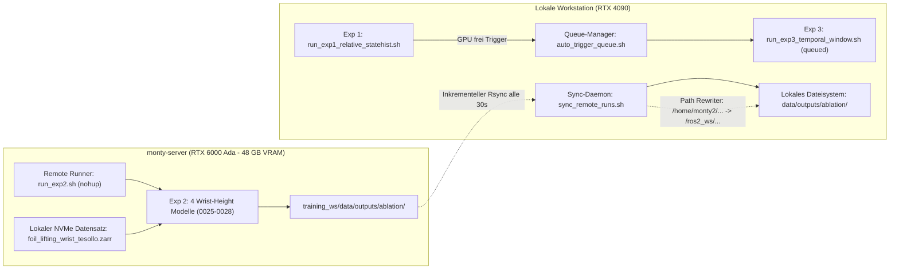

# Remote Multi-GPU Trainings-Workflow & Synchronisation

Dokumentation des aufgesetzten verteilten Trainings-Workflows zwischen der lokalen Workstation und dem dedizierten GPU-Trainingsknoten (`monty-server`).

---

## 1. Systemarchitektur & Hardware



| Instanz | Hardware | Betriebsumgebung | Rolle im Workflow |
| :--- | :--- | :--- | :--- |
| **Lokale Workstation** | NVIDIA RTX 4090 (24 GB) | Docker `ros2_dev` (Ubuntu 24.04, Python 3.12) | Trainiert Exp 1; führt danach Exp 3 aus; hostet den Sync-Daemon |
| **`monty-server`** (`172.17.248.109`) | NVIDIA RTX 6000 Ada (48 GB) | Host venv `~/training_ws/venv` (Python 3.12) | Trainiert Exp 2 autark auf NVMe mit ~6 it/s |

---

## 2. Wesentliche Designentscheidungen

1. **Lokales NVMe-Caching statt Wi-Fi NFS:**
   - Beide Rechner sind per Wi-Fi verbunden (~6–8 MB/s Durchsatz).
   - Das frühere Konzept, Zarr-Datensätze live über NFS zu streamen, führte zu GPU-Starvation (<25 % Auslastung) und Systemhänger bei Paketverlusten.
   - **Lösung:** Der Datensatz (`foil_lifting_wrist_tesollo.zarr`, 16.1 GB, 14.558 Chunks) wurde einmalig auf die 3.0 TB NVMe von `monty-server` kopiert. PyTorch DataLoaders lesen nun mit voller Busgeschwindigkeit (>3 GB/s).

2. **Zero FlashAttention (Strikte Vermeidung von `flash_attn`):**
   - Per Anweisung wurde **kein** `flash_attn` auf dem Server installiert.
   - Der `DiTX`-Backbone von ManiFlow nutzt natives PyTorch SDPA (`F.scaled_dot_product_attention`), welches auf der Ada-Architektur automatisch optimierte FlashAttention-Kernels ohne externe C++/CUDA-Kompilate ausführt.

3. **Queue-Entkopplung:**
   - Der lokale Queue-Manager ([`auto_trigger_queue.sh`](file:///home/mm/dev/il-visual-tactile/third_party/ManiFlow_Policy/scripts/auto_trigger_queue.sh)) wurde so modifiziert, dass er Exp 2 lokal überspringt. Sobald Exp 1 lokal fertig ist, startet automatisch Exp 3 auf der RTX 4090.

---

## 3. Remote Trainings-Pipeline (`monty-server`)

- **Verzeichnisstruktur auf Server:**
  - Code: `~/training_ws/ManiFlow_Policy`
  - Venv: `~/training_ws/venv`
  - Daten: `~/training_ws/data/zarr_datasets/`
  - Outputs: `~/training_ws/data/outputs/`
  - Logs: `~/training_ws/logs/exp2_wrist_height.log`
- **Runner-Skript:** `~/training_ws/run_exp2.sh`
  Führt die 4 Modelle sequentiell aus:
  1. `0025_rel_wrist_height_delta` (relativ, $\Delta z$, `state_history=true`)
  2. `0026_rel_wrist_height_abs` (relativ, $z_{\text{foil}}$, `state_history=true`)
  3. `0027_abs_wrist_height_delta` (absolut, $\Delta z$)
  4. `0028_abs_wrist_height_abs` (absolut, $z_{\text{foil}}$)

---

## 4. Automatischer Rück-Sync & Nahtlose Integration

Das Skript [`sync_remote_runs.sh`](file:///home/mm/dev/il-visual-tactile/scripts/sync_remote_runs.sh) läuft als Hintergrund-Daemon auf der lokalen Workstation:

1. **Inkrementelles Live-Streaming:**
   - Pollt `monty-server` alle 30 Sekunden.
   - Checkpoints (`.ckpt`) und WandB-Dateien werden direkt nach Erstellung übertragen, sodass am Ende kein 30-GB-Übertragungsstau entsteht.
2. **Hydra-Normalisierung ("looks like trained here"):**
   - Erkennt automatisch neue `.hydra`-Ordner und schreibt Pfade in `config.yaml`, `hydra.yaml` und `overrides.yaml` um:
     - `/home/monty2/training_ws/data/` $\to$ `/ros2_ws/data/`
     - `/home/monty2/training_ws/ManiFlow_Policy/` $\to$ `/ros2_ws/third_party/ManiFlow_Policy/`
   - Dadurch können Evaluierungs- und Deployment-Skripte ([`deploy_relative.py`](file:///home/mm/dev/il-visual-tactile/third_party/ManiFlow_Policy/ManiFlow/deploy_relative.py), [`model_serve.py`](file:///home/mm/dev/il-visual-tactile/third_party/ManiFlow_Policy/ManiFlow/model_serve.py)) die Modelle sofort ohne Konfigurationsanpassung laden.
3. **Rechte-Harmonisierung:**
   - Setzt `chmod -R u+rwX,g+rwX,o+rX`, wodurch sowohl der lokale Host-Benutzer (`mm`) als auch Docker-Container (`root`) uneingeschränkten Lese- und Schreibzugriff haben.

---

## 5. Cheat Sheet & Monitoring

### Status & Checkpoints prüfen
```bash
# Zeigt Status des Servers und tabellarische Übersicht aller synchronisierten Modelle
bash /home/mm/dev/il-visual-tactile/scripts/sync_remote_runs.sh --status
```

### Sync-Daemon Log ansehen
```bash
tail -f /home/mm/dev/il-visual-tactile/data/outputs/sync_remote_runs.log
```

### Manuelle Einmal-Synchronisation anstoßen
```bash
bash /home/mm/dev/il-visual-tactile/scripts/sync_remote_runs.sh --once
```

### Server-Training live beobachten
```bash
# GPU Auslastung auf monty-server
ssh monty-server "nvidia-smi"

# Live Trainings-Loss & Epochen-Fortschritt
ssh monty-server "tail -f ~/training_ws/logs/exp2_wrist_height.log"
```
