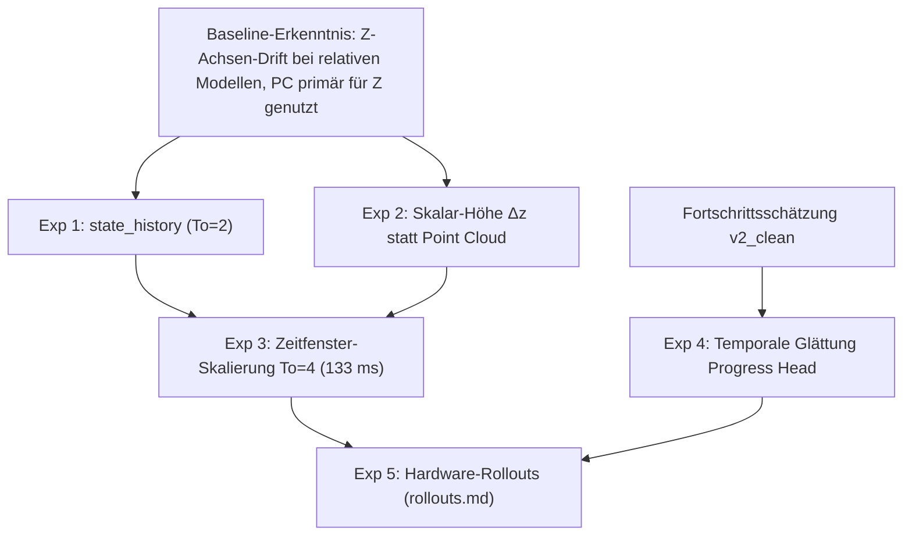

# Experiment-Masterplan: Hypothesen & Versuchsdesign

Dieses Dokument dient als zentrales Planungsinstrument für alle Modell- und Architektur-Experimente.
Ausführliche numerische Auswertungen, Plots und Detailanalysen gehören nicht hierher, sondern werden in den entsprechenden Dokumenten unter **`investigations/`** gepflegt.

## 1. Roadmap der Experimente

---

## 2. Spezifikation der Experimente

### Experiment 1: `state_history` ($T_o = 2$)

* **Hypothese:**
  In relativen Aktionsmodellen ist die aktuelle Pose zum Zeitpunkt $t$ per Definition die Einheits-Pose $(0, I)$. Wird die Historie abgeschnitten, sieht das Netzwerk für den Arm nur eine konstante Null-Bewegung. Die Bereitstellung der Historie ($t-1$ relativ zu $t$) stellt den Geschwindigkeits- und Richtungsvektor wieder her und stabilisiert die Trajektorienkonsistenz.
* **Isolierte Variablenänderung:**
  - `policy.state_history: true` (Einspeisung von $T_o \cdot D_{\text{state}}$ in DiTX statt nur des letzten Schritts $t$).
  - Alle Sensormodalitäten und Parameter bleiben unverändert.
* **Geplante Läufe (80 Epochen, Seed 0):**
  1. `0022_rel_wrist_pc_statehist` (Top-PC + Wrist-RGB)
  2. `0023_rel_wrist_only_statehist` (Wrist-RGB only)
  3. `0024_rel_wrist_front_statehist` (Wrist-RGB + Front-RGB)
* **Erfolgskriterien:**
  1. Statistische Reduktion der Vorhersagestreuung ($K=8$ Seeds) um mind. 20 %.
  2. Messbare Sensitivität auf `shuffle_state_hist` ($> 1.05\times$).
* **Ergebnis-Dokumentation:**
  Detaillierte Auswertung in [`investigations/height_modality/height_modality_and_progress_analysis.md`](file:///home/mm/dev/il-visual-tactile/data/rollouts/analysis/investigations/height_modality/height_modality_and_progress_analysis.md#11-validierungs-mse-und-modalitäts-sensitivität-auf-box_recorded_actionzarr).

---

### Experiment 2: `wrist_plus_scalar_z` (Skalare Höhenkonditionierung statt PointNet)

* **Hypothese:**
  Da die relative Policy die 1024-Punkte-Punktwolke der Top-Kamera fast ausschließlich für die vertikale Höhenachse nutzt, kann die Punktwolke vollständig durch einen kompakten 1D-Höhenskalar ersetzt werden. Dies spart massiv Rechenzeit (PointNet entfällt) und eliminiert Kalibrierungs-Ungenauigkeiten der Außenkamera.
* **Isolierte Variablenänderung:**
  - Punktwolke deaktiviert (`pc_conditioned: false`).
  - Erweiterung des State-Vektors um 1 Höhen-Skalar (17D $\to$ 18D relativ bzw. 15D $\to$ 16D absolut).
* **Vergleich zweier Höhen-Formulierungen:**
  - **Variante 2a (`height_delta`):** $\Delta z = z_{\text{EE}} - z_{\text{foil}}$ (relativer Höhenabstand zur Folienoberfläche; invariant gegen absolute Paletten- oder Tischhöhen).
  - **Variante 2b (`height_abs`):** $z_{\text{foil}}$ (absolute Folienhöhe im Welt-Frame; Gegenhypothese).
* **Geplante Läufe (80 Epochen, Seed 0):**
  1. `0025_rel_wrist_height_delta` (Relativ, $\Delta z$)
  2. `0026_rel_wrist_height_abs` (Relativ, $z_{\text{foil}}$)
  3. `0027_abs_wrist_height_delta` (Absolut, $\Delta z$)
  4. `0028_abs_wrist_height_abs` (Absolut, $z_{\text{foil}}$)
* **Erfolgskriterien:**
  1. $\Delta z$ erreicht oder unterbietet den Validierungs-MSE der Point-Cloud-Baselines.
  2. Hohe Sensitivität auf `shuffle_height` ($> 1.5\times$) gezielt in der `approach`-Phase.
* **Ergebnis-Dokumentation:**
  Detaillierte Auswertung in [`investigations/height_modality/height_modality_and_progress_analysis.md`](file:///home/mm/dev/il-visual-tactile/data/rollouts/analysis/investigations/height_modality/height_modality_and_progress_analysis.md#14-wesentliche-erkenntnisse).

---

### Experiment 3: `temporal_window_scaling` ($T_o = 2 \to T_o = 4$)

* **Hypothese:**
  Ein Rückblick von $T_o=2$ ($67\,\text{ms}$) ist bei 30 Hz zu kurz, um feine Geschwindigkeitsänderungen rauscharm zu erfassen. Eine Verdopplung des Beobachtungshorizonts auf $T_o=4$ ($133\,\text{ms}$) liefert eine stabilere Geschwindigkeitsbasis und glättet die Nahtstellen zwischen aufeinanderfolgenden Aktions-Chunks ($\Delta t = 8$).
* **Isolierte Variablenänderung:**
  - Beobachtungshorizont `n_obs_steps = 4` (statt 2) auf Basis der besten Architektur aus Exp 2 (`wrist + height_delta`).
  - $4 \times 192 = 768$ RGB-Tokens, $4 \times 32 = 128\,\text{dim}$ State-Input.
* **Geplante Läufe (80 Epochen, Seed 0):**
  1. `0029_rel_wrist_height_delta_to4` (Relativ, $\Delta z$, $T_o=4$)
  2. `0030_abs_wrist_height_delta_to4` (Absolut, $\Delta z$, $T_o=4$)
* **Erfolgskriterien:**
  1. Signifikante Reduktion des Chunk-Seam-Disagreements ($\Delta t = 8$).
  2. Anstieg der Sensitivität auf die Historie (`shuffle_state_hist` $> 1.2\times$).
* **Ergebnis-Dokumentation:**
  Detaillierte Auswertung in [`investigations/height_modality/height_modality_and_progress_analysis.md`](file:///home/mm/dev/il-visual-tactile/data/rollouts/analysis/investigations/height_modality/height_modality_and_progress_analysis.md#13-vorhersage-konsistenz-k8-rausch-seeds-bei-identischer-beobachtung--chunk-seam-delta-t--8).

---

### Experiment 4: Progress Head Temporale Glättung (`smooth_weight`, `delta_max`)

* **Hypothese:**
  Eine unregulierte Punktschätzung des Fortschritts neigt im Rollout zu Zitter-Ausschlägen und verfrühten Stop-Triggern. Ein asymmetrischer Straf-Term für sprunghafte Änderungen $\Delta y > \Delta_{\max}$ dämpft hochfrequentes Rauschen, ohne reale Fortschrittsanstiege zu verzögern.
* **Isolierte Variablenänderung:**
  - Verlustfunktion: $\mathcal{L} = \mathcal{L}_{\text{Huber}} + w_{\text{smooth}} \cdot \text{ReLU}(|\hat{y}_{t+1} - \hat{y}_t| - \Delta_{\max})^2$.
  - Systematische Variation von $w_{\text{smooth}} \in \{0.0, 0.05, 0.10\}$ und $\Delta_{\max} \in \{0.02, 0.03\}$.
* **Geplante Läufe (30 Epochen auf `progress_split_70_30.json`):**
  1. `prg_0001_baseline_v2_clean`: $w_{\text{smooth}} = 0.0, \Delta_{\max} = 0.03$ (Baseline ohne Glättung)
  2. `prg_0002_smooth_w005`: $w_{\text{smooth}} = 0.05, \Delta_{\max} = 0.03$ (Moderate Glättung)
  3. `prg_0003_smooth_w010`: $w_{\text{smooth}} = 0.10, \Delta_{\max} = 0.02$ (Strikte Glättung)
* **Erfolgskriterien:**
  1. $\text{Val-MAE} < 0.105$ (kein relevanter Genauigkeitsverlust gegenüber der Baseline).
  2. False-Positive-Rate bei der 90-%-Schwelle unter $2.0\,\%$.
  3. Stabile Konvergenz ohne vorzeitiges Trainings-Plateau.
* **Ergebnis-Dokumentation:**
  Detaillierte Auswertung in [`investigations/height_modality/height_modality_and_progress_analysis.md`](file:///home/mm/dev/il-visual-tactile/data/rollouts/analysis/investigations/height_modality/height_modality_and_progress_analysis.md#2-auswertung-der-progress-heads-prg_0001prg_0003).

