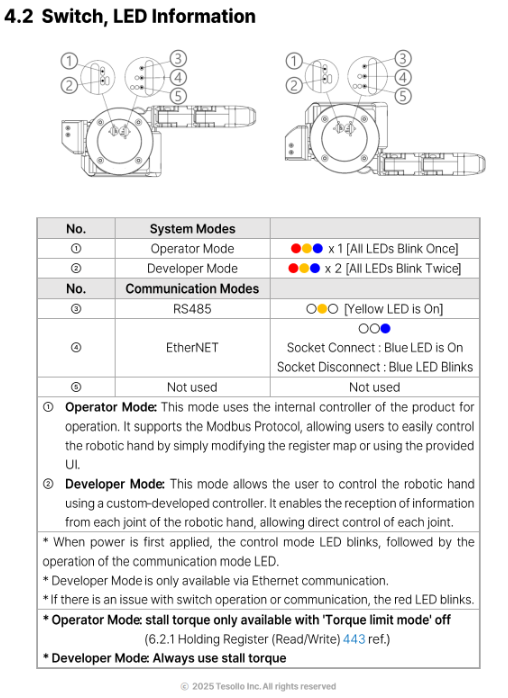

# SenseGlove Robotics - Integration Guide
This is tested on Ubuntu 24.04; should be compatible with other distros.

## First-time Setup

Run the setup script to install Docker and `uv`, and log in to Docker Hub:

```bash
bash setup.sh
```

When prompted, paste the Docker Hub token provided by SenseGlove. You only need to do this once.

> If Docker was just installed, log out and log back in before continuing.

Then pull the image:

```bash
uv run image_manager.py --pull
```

---

## SenseGlove R1

### Running

```bash
uv run start.py r1
```

### Options

```bash
# One glove connected
uv run start.py r1 --num-gloves 2

# Two gloves connected
uv run start.py r1 --num-gloves 2

# Simulation mode (no hardware needed)
uv run start.py r1 --simulation

# Simulation without GUI
uv run start.py r1 --simulation --no-gui
```

---

## SenseGlove Tesollo

### Hardware Setup

The DG5F hand communicates over Ethernet (Modbus TCP). Create a wired network profile with IPv4 set to manual:

| Address          | Netmask         | Gateway   |
|---               |---              |---        |
| `169.254.166.80` | `255.255.255.0` | `0.0.0.0` |

Verify the connection:

```bash
ping 169.254.186.72   # right hand
ping 169.254.186.73   # left hand
```

> Ensure the hand is in Developer Mode with switches ② and ④ in the correct positions.



### Running

```bash
## Args:
# hand:  Handedness of Tesollo
# glove-id: SenseGlove R1 Glove serial

# Right hand
uv run start.py tesollo --hand right --glove-id 50

# Left hand
uv run start.py tesollo --hand left --glove-id 50

# Gazebo simulation
uv run start.py tesollo --launch dg5f_robot_hand_mapper_gazebo --hand right --glove-id 50
```
---

## Running Both Simultaneously

Open two terminals and run each product in its own terminal. They use separate containers and will not interfere with each other.

---

## Shell Access

Drop into an interactive shell inside the container:

```bash
uv run start.py bash
```

Target a specific image version with `--tag`:

```bash
uv run start.py bash --tag r1-latest
```

---

## Image Management

```bash
# Pull the latest image
uv run image_manager.py --pull

# Pull a specific version
uv run image_manager.py --pull --tag 1.2.0

# Check what image is installed locally
uv run image_manager.py -c
```

---

## Troubleshooting

**`docker: permission denied`**
```bash
sudo usermod -aG docker $USER
# then log out and back in
```

**`pull access denied`**
Your Docker Hub token may have expired. Contact SenseGlove for a new one, then:
```bash
docker login -u zippeth
```

**`uv: command not found`**
```bash
source $HOME/.local/bin/env
```

**Display / GUI not showing**
```bash
xhost +local:docker
```
